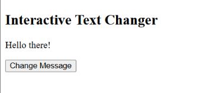
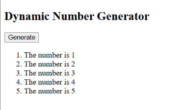

BIC21203 – Lab 4a: Client-Side Scripting (JavaScript)

Introduction
This repository contains the solutions for Lab 4a, focusing on client-side scripting using JavaScript.

Lab Questions

Question 1 – Interactive Text Changer
Changes a paragraph's text when the user clicks a button using JavaScript DOM manipulation and event handling.

Question 2 – Smart Number Validator
Accepts a number from the user and displays a validation message using conditional statements.

Question 3 – Dynamic Number Generator
Generates an ordered list of numbers from 1 to 5 using a JavaScript for loop and DOM manipulation.

How to Run
1. Download or clone this repository.
2. Open the Q1, Q2 or Q3 folder.
3. Open the corresponding HTML file in a web browser.

Technologies Used
- HTML5
- JavaScript

Student Information
- Name:NURUL SUHAILA BINTI MOHD HANAFI
- Student ID:AI240076

Screenshots

Question 1 – Interactive Text Changer

Question 2 – Smart Number Validator
Test 1: Number lower than 10

Test 2: Invalid input

Question 3 – Dynamic Number Generator

